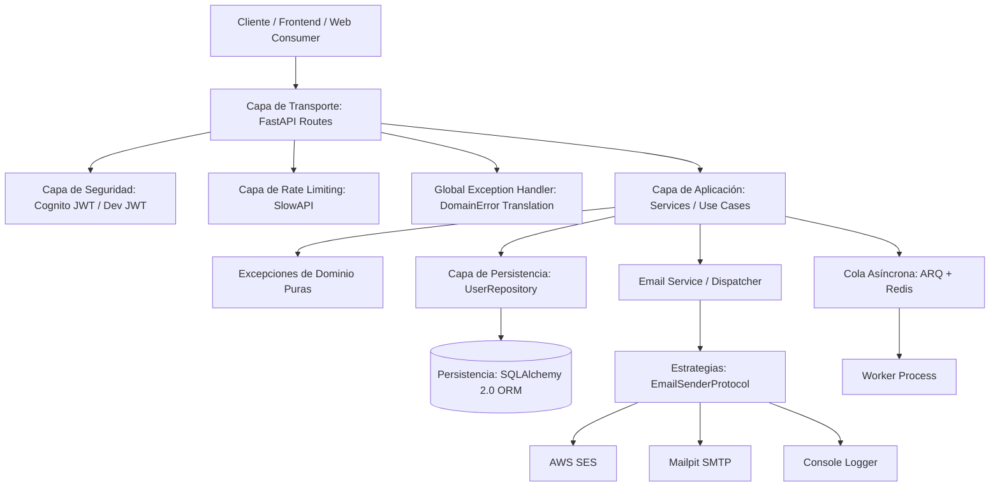

[English](ARCHITECTURE.md) | [Español](ARCHITECTURE.es.md)

# Arquitectura del Sistema: Screaming Modular Monolith (Lite Edition)

Este documento describe los principios arquitectónicos, las decisiones de diseño (ADRs), el modelo de componentes y las reglas estructurales que rigen `fastapi-saas-boilerplate` (Lite Edition).

---

## 1. Visión Arquitectónica

El proyecto implementa una arquitectura **Screaming Modular Monolith** adaptada a Python y FastAPI. El objetivo principal es que la estructura del código **grite el dominio del negocio** (Autenticación, Usuarios y Privacidad GDPR) en lugar de la tecnología subyacente, manteniendo una separación estricta de responsabilidades (SOLID), POO y Patrones de Diseño.



---

## 2. Estructura de Directorios

```text
api/
├── core/                        # CAPA TRANSVERSAL (Infraestructura Compartida)
│   ├── config.py                # Configuración y variables de entorno (Pydantic Settings)
│   ├── database.py              # Motor SQLAlchemy 2.0, DeclarativeBase y Sesiones
│   ├── exceptions.py            # Jerarquía de excepciones de dominio (SRP)
│   ├── security.py              # Autenticación (Cognito RS256 JWT + Dev JWT HS256)
│   ├── limiter.py               # Rate limiting distribuido (SlowAPI)
│   ├── email.py                 # Strategy Pattern para emails (Smtp, Ses, Console)
│   ├── logging/                 # Observabilidad y tracing
│   │   ├── logger.py            # RichHandler en dev/tests, JSON en prod
│   │   └── middleware.py        # Registro de accesos y latencia con X-Request-ID
│   └── protocols/               # Contratos abstractos (DIP / Interfaces)
│       ├── email.py             # EmailSenderProtocol
│       ├── identity.py          # IdentityProviderProtocol
│       ├── jwt.py               # JwtAuthenticatorProtocol
│       └── api_key_provider.py  # NullApiKeyValidator (Null Object Pattern)
│
├── modules/                     # CAPA DE DOMINIO (Feature Modules)
│   ├── auth/                    # Autenticación y desarrollo local
│   │   ├── schemas.py           # Contratos DTO (DevUserRead, DevLoginRequest, etc.)
│   │   └── routes.py            # Endpoints /auth/dev-login y /auth/dev-users
│   │
│   └── users/                   # Identidad, Perfil, Preferencias y Privacidad GDPR
│       ├── models.py            # Modelos ORM tipados Mapped (UserProfile, UserSettings)
│       ├── schemas.py           # Contratos DTO de entrada/salida (Pydantic v2)
│       ├── privacy_schemas.py   # DTOs de exportación y anonimización GDPR (Art. 15, 17, 20)
│       ├── repository.py        # UserRepositoryProtocol y SqlAlchemyUserRepository
│       ├── services.py          # Casos de uso de negocio (UserService)
│       ├── privacy_service.py   # Casos de uso de privacidad (PrivacyService)
│       └── routes.py            # Thin Controller HTTP (/users/me, /users/settings, etc.)
│
├── templates/                   # Plantillas HTML responsivas para emails
│   └── emails/
├── worker.py                    # Worker asíncrono para tareas en background (ARQ + Redis)
└── main.py                      # Ensamblado del framework, Lifespan y Exception Handlers
```

---

## 3. Cumplimiento de Principios SOLID y Patrones de Diseño

| Principio / Patrón | Aplicación en el Proyecto |
| :--- | :--- |
| **S - Single Responsibility** | Las rutas (`routes.py`) solo gestionan el transporte HTTP. La lógica de negocio reside en `services.py`. Las consultas a base de datos están encapsuladas en `repository.py`. Los servicios no importan `HTTPException`, sino que lanzan `DomainError`. |
| **O - Open/Closed** | El sistema de envío de emails utiliza el **Strategy Pattern** implementando `EmailSenderProtocol`. Para añadir un nuevo proveedor (ej. Resend o SendGrid), se añade una nueva clase sin modificar código existente. |
| **L - Liskov Substitution** | Cualquier clase que implemente `EmailSenderProtocol` (`SmtpEmailSender`, `SesEmailSender`, `ConsoleEmailSender`) o `IdentityProviderProtocol` (`CognitoIdentityProvider`, `MockIdentityProvider`) puede sustituirse sin romper el comportamiento del sistema. |
| **I - Interface Segregation** | Los protocolos son pequeños, atómicos y específicos (`EmailSenderProtocol`, `IdentityProviderProtocol`, `UserRepositoryProtocol`) en lugar de interfaces monolíticas. |
| **D - Dependency Inversion** | Los servicios de dominio dependen de interfaces abstractas y repositorios inyectados en tiempo de ejecución (`Depends()`), nunca de SDKs concretos ni sesiones crudas. |
| **Repository Pattern** | `SqlAlchemyUserRepository` centraliza las operaciones de persistencia de usuarios y configuraciones. |
| **Null Object Pattern** | `NullApiKeyValidator` proporciona un comportamiento seguro por defecto para solicitudes con API Keys en la edición Lite. |

---

## 4. Reglas de Arquitectura

1. **Rutas Delgadas (Thin Controllers)**:
   - Ninguna función en `routes.py` debe ejecutar consultas SQL directas ni llamadas a SDKs externos.
   - `routes.py` solo valida entrada, resuelve dependencias (`Depends`), invoca el método del `Service` y retorna la respuesta.

2. **Excepciones de Dominio Desacopladas**:
   - Los servicios en `services.py` levantan excepciones de `api.core.exceptions`.
   - FastAPI las traduce de forma transparente a respuestas HTTP con el código de estado adecuado (400, 404, etc.) mediante `@app.exception_handler(DomainError)`.

3. **Inversión en Repositorios**:
   - Todo acceso a la base de datos se realiza a través de `UserRepositoryProtocol` / `SqlAlchemyUserRepository`.

---

## 5. Modelo de Seguridad y Autenticación

- **JWT de AWS Cognito**: Validado mediante firma criptográfica RS256 contra las claves públicas JWKS de Cognito en producción.
- **Dev JWT Local**: Tokens firmados con HS256 generados mediante `/auth/dev-login` para desarrollo rápido sin depender de la nube.
- **API Keys**: En esta edición Lite se aplica el **Null Object Pattern**, rechazando de manera controlada con `401 Unauthorized`.

---

## 6. Sistema de Background Workers

- **ARQ + Redis**: En producción, las tareas diferidas (envío de emails transaccionales, anonimización en IdP) se encolan en Redis mediante `enqueue_job()`.
- **Fallback Síncrono Automático**: En entornos locales o tests sin Redis, el sistema ejecuta la tarea directamente con resiliencia total.

---

## 7. Observabilidad y Logging

- **Desarrollo**: Logs formateados con `RichHandler` (`rich.traceback` con trazas claras).
- **Producción**: Formateador estructurado `JSONFormatter` para CloudWatch, Datadog o Grafana Loki.
- **Trazabilidad (`X-Request-ID`)**: Generación o propagación de UUIDv4 por cada petición HTTP y cálculo de latencia en milisegundos.
