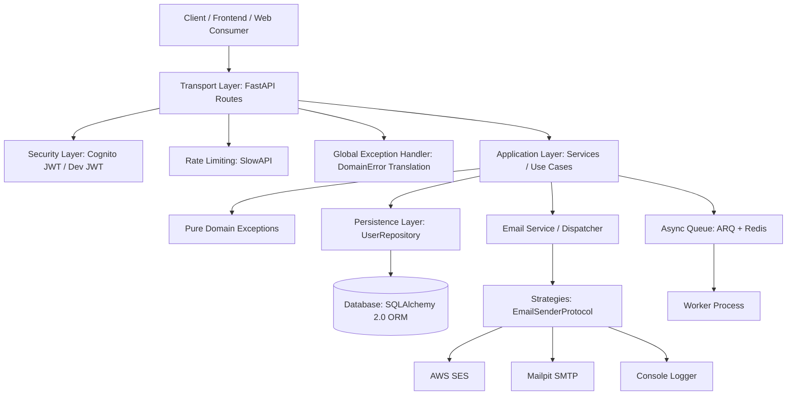

[English](ARCHITECTURE.md) | [Español](ARCHITECTURE.es.md)

# System Architecture: Screaming Modular Monolith (Lite Edition)

This document describes the architectural principles, design decisions (ADRs), component model, and structural rules governing `fastapi-saas-boilerplate` (Lite Edition).

---

## 1. Architectural Vision

The project implements a **Screaming Modular Monolith** tailored to Python and FastAPI. The core goal is for the directory and code structure to **scream the business domain** (Authentication, User Profiles, and GDPR Privacy) rather than underlying technical frameworks, maintaining strict adherence to **SOLID principles**, **OOP**, and **Design Patterns**.



---

## 2. Directory Structure

```text
api/
├── core/                        # CROSS-CUTTING LAYER (Shared Infrastructure)
│   ├── config.py                # Environment configuration (Pydantic Settings)
│   ├── database.py              # SQLAlchemy 2.0 Engine, DeclarativeBase & Sessions
│   ├── exceptions.py            # Domain exceptions hierarchy (SRP)
│   ├── security.py              # Auth (Cognito RS256 JWT + Local Dev JWT HS256)
│   ├── limiter.py               # Distributed rate limiting (SlowAPI)
│   ├── email.py                 # Strategy Pattern for emails (Smtp, Ses, Console)
│   ├── logging/                 # Observability and tracing
│   │   ├── logger.py            # RichHandler in dev/tests, JSON in prod
│   │   └── middleware.py        # Request logging & latency tracking with X-Request-ID
│   └── protocols/               # Abstract contracts (DIP / Interfaces)
│       ├── email.py             # EmailSenderProtocol
│       ├── identity.py          # IdentityProviderProtocol
│       ├── jwt.py               # JwtAuthenticatorProtocol
│       └── api_key_provider.py  # NullApiKeyValidator (Null Object Pattern)
│
├── modules/                     # DOMAIN LAYER (Feature Modules)
│   ├── auth/                    # Dev authentication & bypass
│   │   ├── schemas.py           # DTO contracts (DevUserRead, DevLoginRequest, etc.)
│   │   └── routes.py            # Endpoints /auth/dev-login and /auth/dev-users
│   │
│   └── users/                   # Identity, Profile, Settings & GDPR Privacy
│       ├── models.py            # Typed SQLAlchemy 2.0 models (UserProfile, UserSettings)
│       ├── schemas.py           # Request/Response DTO contracts (Pydantic v2)
│       ├── privacy_schemas.py   # GDPR Export & Anonymization DTOs (Art. 15, 17, 20)
│       ├── repository.py        # UserRepositoryProtocol & SqlAlchemyUserRepository
│       ├── services.py          # Domain business rules (UserService)
│       ├── privacy_service.py   # Privacy & GDPR use cases (PrivacyService)
│       └── routes.py            # Thin HTTP controllers (/users/me, /users/settings, etc.)
│
├── templates/                   # Responsive HTML email templates
│   └── emails/
├── worker.py                    # Background job worker (ARQ + Redis fallback)
└── main.py                      # App assembly, Lifespan & Exception Handlers
```

---

## 3. SOLID Principles & Design Patterns

| Principle / Pattern | Project Implementation |
| :--- | :--- |
| **S - Single Responsibility** | Routes (`routes.py`) only handle HTTP transport. Business logic lives in `services.py`. Database queries are encapsulated in `repository.py`. Services do not import `HTTPException`, but raise pure `DomainError`. |
| **O - Open/Closed** | Email delivery uses the **Strategy Pattern** implementing `EmailSenderProtocol`. To support a new provider (e.g. Resend, SendGrid), add a class without editing existing service logic. |
| **L - Liskov Substitution** | Any implementation of `EmailSenderProtocol` (`SmtpEmailSender`, `SesEmailSender`, `ConsoleEmailSender`) or `IdentityProviderProtocol` (`CognitoIdentityProvider`, `MockIdentityProvider`) can be substituted cleanly without breaking consumers. |
| **I - Interface Segregation** | Protocols are concise, granular, and focused (`EmailSenderProtocol`, `IdentityProviderProtocol`, `UserRepositoryProtocol`) rather than bloated monolithic interfaces. |
| **D - Dependency Inversion** | High-level domain services depend on abstract protocols and injected repositories (`Depends()`), never on concrete SDK clients or raw database sessions. |
| **Repository Pattern** | `SqlAlchemyUserRepository` centralizes user persistence, retrieval, and soft-anonymization. |
| **Null Object Pattern** | `NullApiKeyValidator` provides a safe default handler rejecting API key requests with `401 Unauthorized` in the Lite edition. |

---

## 4. Architectural Rules

1. **Thin Controllers**:
   - Routes in `routes.py` never execute raw SQL queries or call third-party SDKs directly.
   - Controllers validate request DTOs, resolve dependencies via FastAPI `Depends`, call the corresponding `Service` method, and return the response.

2. **Decoupled Domain Exceptions**:
   - Domain services raise exceptions defined in `api.core.exceptions` (`UserValidationError`, `ActiveTrialExistsError`, etc.).
   - FastAPI intercepts `DomainError` via a global exception handler in `api/main.py` and maps it to appropriate HTTP status codes (400, 404, 422).

3. **Repository Abstraction**:
   - All database reads and writes flow through `UserRepositoryProtocol` / `SqlAlchemyUserRepository`.

---

## 5. Security & Authentication Model

- **AWS Cognito JWT**: Verified in production using RS256 asymmetric cryptographic signature against Cognito JWKS public keys.
- **Local Dev JWT**: Symmetric HS256 tokens generated via `/auth/dev-login` for zero-friction local development without cloud dependencies.
- **API Keys**: In this Lite edition, the **Null Object Pattern** safely rejects API key requests with standard `401 Unauthorized`.

---

## 6. Background Worker System

- **ARQ + Redis**: In production, asynchronous tasks (sending emails, identity provider cleanup) are dispatched to Redis via `enqueue_job()`.
- **Automatic Synchronous Fallback**: In local or test environments without Redis, tasks execute synchronously with full resilience and zero downtime.

---

## 7. Observability & Logging

- **Development**: Formatted console output using `RichHandler` (`rich.traceback` with clear, colorful tracebacks).
- **Production**: Structured JSON logs (`JSONFormatter`) ready for ingestion by CloudWatch, Datadog, or Grafana Loki.
- **Request Tracing (`X-Request-ID`)**: Generates or propagates a UUIDv4 on every incoming HTTP request and records execution latency in milliseconds.
